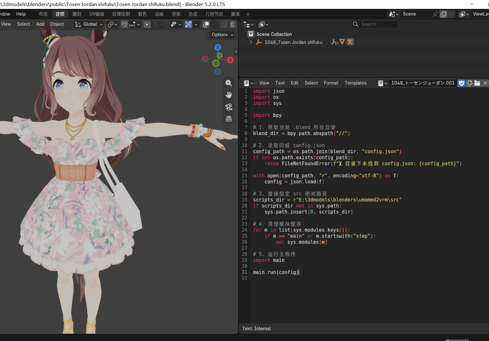

# UmaViewer MMD to VRM 1.0 Converter

As we all know, manually modifying original models in Blender/VRoid Studio is a f***k*ing paiful process,and it often makes hard-to-catch bugs. 

To solve this, I developed a bpy-based pipeline to automatically convert MMD models into the VRM 1.0 format.

The repository is target to [UmaViewer](https://github.com/katboi01/UmaViewer) MMD Models Structure.It's for personal, educational, and non-commercial purposes.
([my related work](https://github.com/SUXUING-star/wwmmd2vrm))

---

## Requirements

1. **Blender** (4 ~ 5.2)
2. **Required Add-ons:**
   * **[mmd_tools](https://github.com/powup333/blender_mmd_tools)**
   * **[VRM Add-on for Blender](https://vrm-addon-for-blender.info/en/)**

---

## Model Configuration (`config.json`)

Each character directory in `public/` requires a `config.json` next to the `.blend` file.

```json
{
    "jp_name": "メジロブライト",
    "en_name": "Mejiro Bright",
    "texture_dir": "Texture2D",
    "vrma_path": ["./motion.vrma"],
    "scripts_dir": "src",
    "metadata": {
        "vrm_name": "Mejiro Bright",
        "version": "1.0.0",
        "author": "suxing-star",
        "copyright": "",
        "contact": "",
        "reference": "",
        "third_party_licenses": "None",
        "other_license_url": "",
        "thumbnail_path": "",
        "avatar_permission": "everyone",
        "allow_excessively_violent_usage": false,
        "allow_excessively_sexual_usage": false,
        "commercial_usage": "personalNonProfit",
        "allow_political_or_religious_usage": false,
        "allow_antisocial_or_hate_usage": false,
        "credit_notation": "required",
        "allow_redistribution": false,
        "modification": "prohibited"
  }
}
```

---

## Usage

1. **Import PMX:** Import the `.pmx` model into Blender using `mmd_tools` and convert materials to Principled BSDF. Save the `.blend` file.
2. **Verify Setup:** Ensure `config.json` and `Texture2D/`(or other name) are in the same folder as the `.blend` file.
3. **Run Pipeline:** Open `blender.py` in Text Editor and edit the code path(the repsitory clone path),then you just copy the `blender.py` into the Blender's Text Editor,and click **Run Script**,the model will export in your project path.
4. **Check Model**: Now you got a waifu VRM model with cute material like in game finally.


---

## Pipeline Description

1. **Extract Spring Bones** (Extract MMD rigid bodies & convert to VRM Spring Bones)
<br>↓
2. **Clean Mesh & Bones** (Fix normals, remove unused rigid bodies, joints, and auxiliary bones)
<br>↓
3. **Bind Expressions** (Normalize shape key names and bind to VRM Expressions)
<br>↓
4. **Bake Textures** (Composite eye highlights & pack UV textures)
<br>↓
5. **Setup Materials** (Configure VRM MToon shaders)
<br>↓
6. **Write Metadata** (Set VRM 1.0 metadata)
<br>↓
7. *(Optional)* **Inject Animation** (Import & attach animation files)
